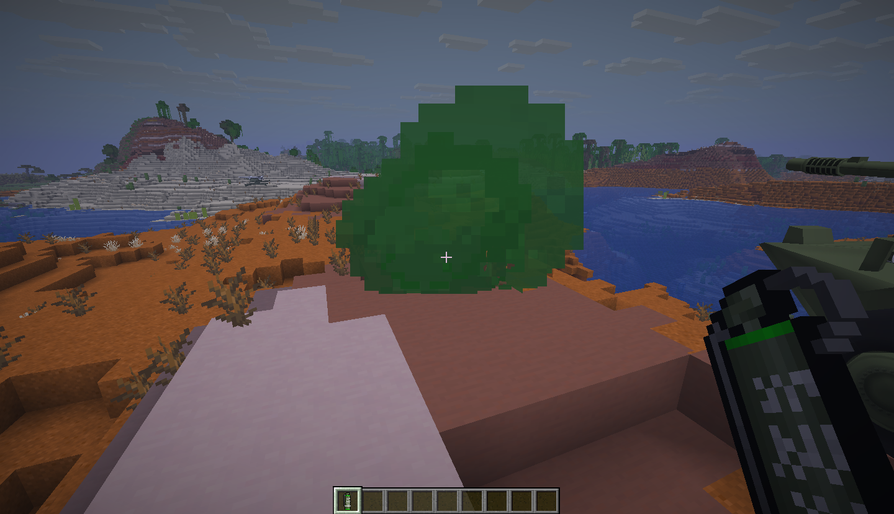
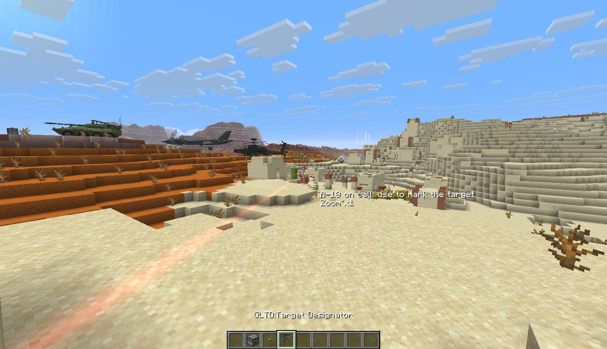
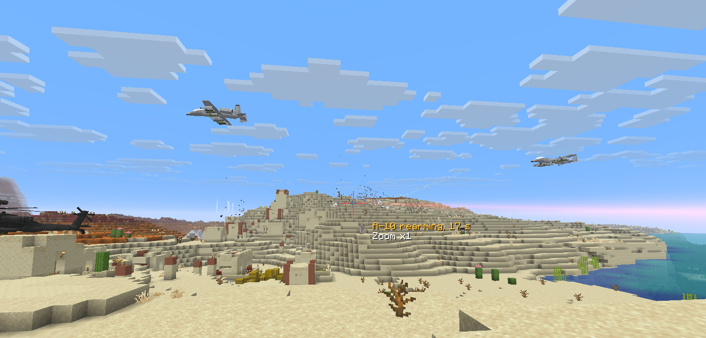
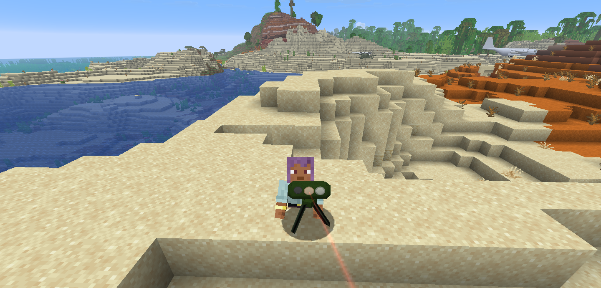
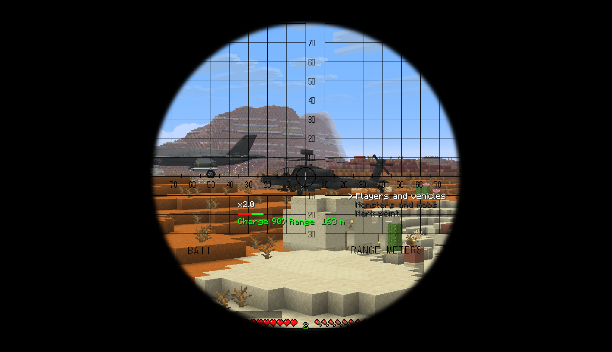
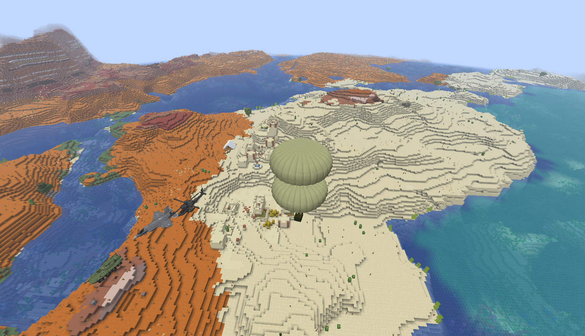
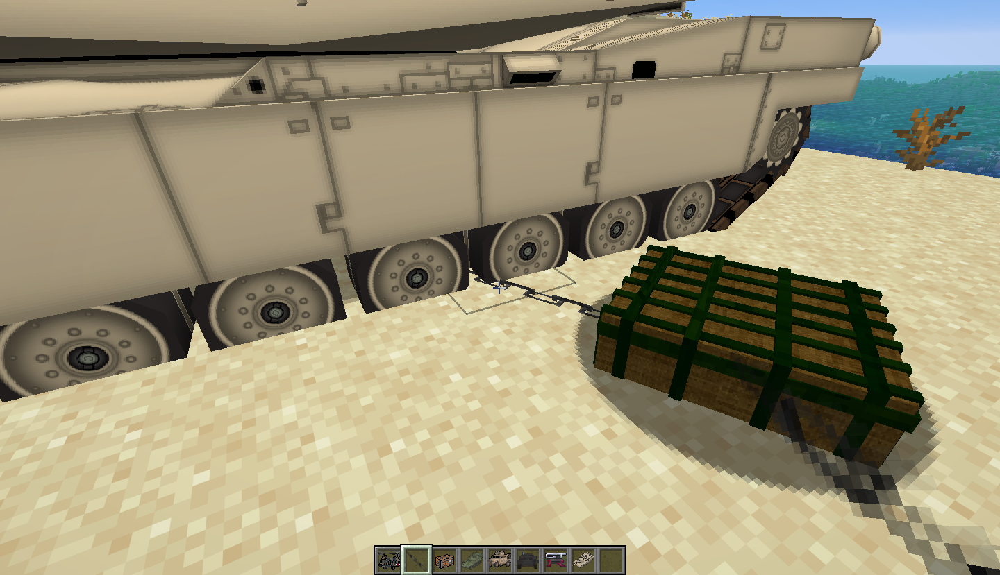
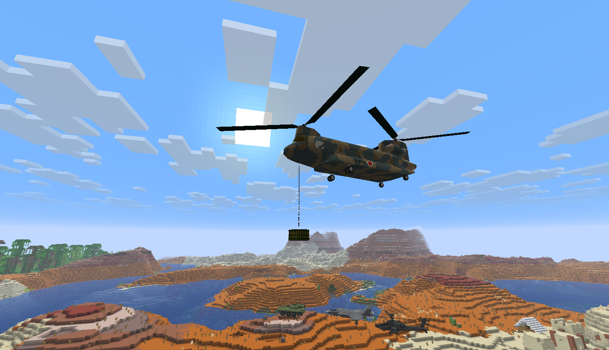

# MCHeli Rework


Helicopters, planes, tanks and ground vehicles for **Minecraft 26.3** and **1.21.1**, on **Forge**,
**NeoForge** and **Fabric**.

MCHeli Rework is a ground-up port of MCHeli 1.0.3, a mod that stopped at Minecraft 1.7.10. Every
system is rewritten for the modern game, while the original vehicle definitions, models,
textures and sounds load unchanged.

> **Status:** on the way to 1.1.0, now at phase 10 (`1.1.0-beta.6`). Every helicopter, plane,
> tank, car and ground vehicle can be placed, crewed and driven with the original handling, all
> 229 weapons fire, and the scripted HUDs, fuel, the vehicle screen and most of the equipment are
> in. Betas 4 to 8 ship the Forge 26.3 jar only; every loader and Minecraft version comes back for
> 1.1.0. See the [roadmap](docs/ROADMAP.md).

## Showcase video

Helicopters, jets and tanks of `1.0.0-alpha.3` in action, on YouTube:

[](https://youtu.be/IFQBb0iH9dc)

Phase 4 clips (click a picture to open the video):

| | |
|---|---|
| [](https://youtu.be/Uc0Unk2VQRA) | [](https://youtu.be/7h6uk0HqH1s) |
| AC-130 gunner mode: the autopilot circles while the pilot works the guns | S-75 lock-on: an SA-2 brings down a helicopter, which goes up in the crash fireball |

## Screenshots

Phase 10 in a development build (`1.1.0-beta.6`): smoke grenades, the GLTD target designator, the
rangefinder, cargo containers and the tow chain. Every earlier phase is in the
[screenshot gallery](docs/SCREENSHOTS.md).

| | |
|---|---|
|  |  |
| An M18 smoke grenade marks a spot in green | Through the GLTD's sight, with the A-10 on call |
|  |  |
| The A-10 makes its gun runs over the marked spot | The GLTD from outside: the head follows the aim, with a faint laser |
|  |  |
| The rangefinder reads the range to an AH-64 | A container dropped from a rack comes down under a parachute |
|  |  |
| An M1A2 with a container on the tow chain | A CH-47 carries a container as a sling load |

## Credits

MCHeli was created by **EMB4**, a Japanese mod author who first published it on the
[minecraftuser.jp forum](http://forum.minecraftuser.jp/viewtopic.php?f=13&t=14837). Its English
home is the CurseForge project
[MCHeli Minecraft Helicopter Mod](https://www.curseforge.com/minecraft/mc-mods/mcheli-minecraft-helicopter-mod)
(project 224304), maintained by [**Fureniku**](https://www.curseforge.com/members/fureniku), with
more than 1.5 million downloads. The last release, 1.0.3, came out for Minecraft 1.7.10 and the
project page states it will not be updated further.

All vehicle content (definitions, models, textures, sounds and HUD scripts) is EMB4's work. The
mod does not ship it: on first start it converts the player's own copy of the original 1.0.3 zip
to the modern resource layout. This repository holds none of it either; the unit tests import
the same zip.

The rework is by **JayMar921** ([JnH Projects](https://github.com/JnH-Projects)).

## Licensing note

The original mod is published as **All Rights Reserved**, and its CurseForge page states that EMB4
gave redistribution permission to Fureniku only. The released jar therefore contains none of the
original files: only the new Java code and the rework's own translations. Players download the
original zip from the CurseForge page themselves, and the mod converts it on their machine.

This repository holds no original files either; the unit tests import the developer's own copy
of the zip.

The rework's own code is under the [MCHeli Rework Licence](LICENSE): play it anywhere, include
official releases in free modpacks, read and build the source, and send pull requests.
Redistributing the source, modified builds or forks, and selling the mod need written
permission. Content packs you make are yours. Because the engine is a rework of EMB4's All Rights
Reserved original, the code is source available rather than open source.

## Requirements

| | Minecraft 26.3 | Minecraft 1.21.1 |
|---|---|---|
| Forge | 66.1.0 or newer in the 66.x line | 52.1.0 or newer |
| NeoForge | 26.3.0.99 or newer | 21.1.200 or newer |
| Fabric | Loader 0.20 and Fabric API | Loader 0.16 and Fabric API |
| Java | 25 (bundled with the launcher) | 21 (bundled with the launcher) |

## Installing

1. Install Forge, NeoForge or Fabric for Minecraft 26.3 or 1.21.1. On Fabric, also install
   [Fabric API](https://modrinth.com/mod/fabric-api).
2. Download the jar for your loader from the
   [releases](https://github.com/JnH-Projects/MCHeli-Rework-Forge/releases):
   `mcheli-<loader>-<minecraft>-<version>.jar`, such as `mcheli-fabric-1.21.1-<version>.jar`.
3. Drop it into the `mods` folder of that profile.
4. Download `MC1.7.10_mcheli_1.0.3.zip` from the
   [MCHeli CurseForge page](https://www.curseforge.com/minecraft/mc-mods/mcheli-minecraft-helicopter-mod/files)
   and put it, still zipped, into a folder called `mcheli` next to `mods` (create it if needed):

   ```
   <game directory>/
     mods/mcheli-<loader>-<minecraft>-<version>.jar
     mcheli/MC1.7.10_mcheli_1.0.3.zip
   ```

On the next start the mod converts the zip into `mcheli/imported`, which takes a few seconds once.
That folder is loaded as a resource pack and a data pack (listed as "MCHeli Content") and can't
be switched off. The zip can be deleted afterwards. Dedicated servers need the zip in the same
place. Without it the game still starts, but there are no vehicles, and the chat says where the
zip goes.

Use a separate game directory for each loader and version. Mods built for other loaders or older
versions in a shared `mods` folder will stop the game from starting. Worlds and the `mcheli`
folder can move between loaders on the same Minecraft version: the imported content, content packs
and configs are the same files on all three. Do not open a 26.3 world in 1.21.1.

## Playing

Take a vehicle from one of the MCHeli creative tabs, right-click a block to place it and
right-click the vehicle to board; in survival, craft it with the original's recipe. W and S work
the throttle, the mouse flies or aims, right mouse fires and Shift gets out. Every key can be
rebound under Controls, category MCHeli.

The full controls for each kind of vehicle, fuel and repairs, the equipment (parachute, smoke
grenades, GLTD, rangefinder, Stinger and Javelin, container, tow chain) and the commands and
server settings are in
[docs/PLAYING.md](docs/PLAYING.md).

## Content packs

Content packs add vehicles and weapons: drop a pack (a zip or a folder) into
`<game dir>/mcheli/packs`. On a server only the server needs it; players download the server's
packs automatically when they join. [examples/rework-example-pack](examples/rework-example-pack)
adds a small helicopter, the Rework Scout. To make your own, see
[docs/content/packs.md](docs/content/packs.md).

## Documentation

* [Playing](docs/PLAYING.md): controls, equipment, commands and server settings
* [Screenshots](docs/SCREENSHOTS.md): every phase in pictures
* [Changelog](CHANGELOG.md)
* [Roadmap](docs/ROADMAP.md): what each phase delivered, and what is planned for 1.1.0
* [Architecture](docs/ARCHITECTURE.md): how the mod is put together
* [Development](docs/DEVELOPMENT.md): building, running, testing and releasing
* [In-game test plan](docs/TESTING.md)
* Content authoring: [content packs](docs/content/packs.md), [modeling in Blockbench or Blender](docs/content/modeling.md), [vehicles](docs/content/aircraft.md), [weapons](docs/content/weapons.md), [HUD scripts](docs/content/hud.md)
* [Contributing](CONTRIBUTING.md): rules for pull requests and bug reports

## Building from source

```
./gradlew build
```

The jars, one per loader and Minecraft version, end up in `build/release`. Java 25 is required;
Gradle downloads one automatically if it is not installed. `./gradlew :<loader>-26.3:runClient`
and `:<loader>-26.3:runServer` (`forge`, `neoforge` or `fabric`) import the content from
`Mod/MC1.7.10_mcheli_1.0.3.zip`, which you have to download yourself. See
[DEVELOPMENT.md](docs/DEVELOPMENT.md) for details.
