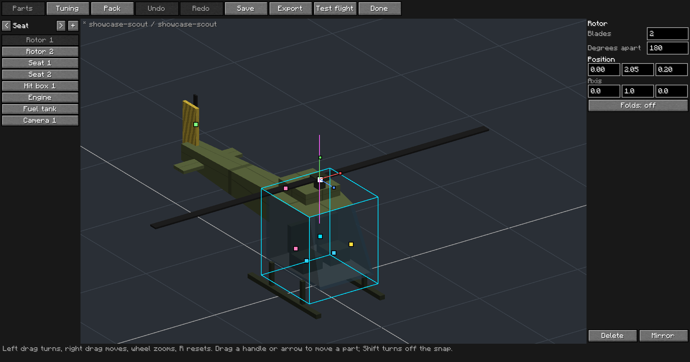
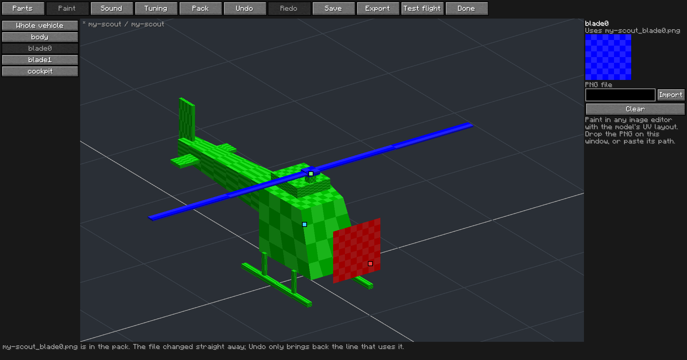
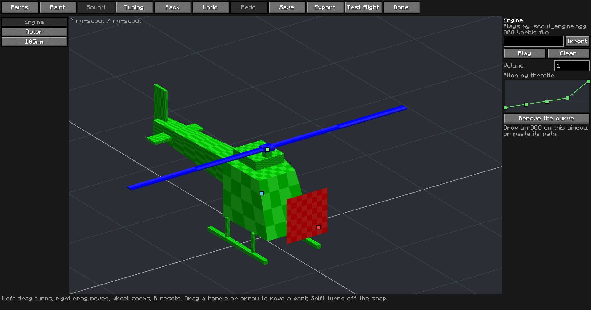
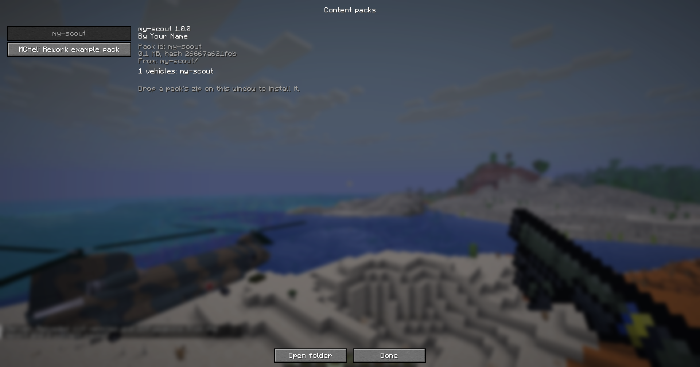

# The vehicle workshop

The workshop builds a vehicle in game: bring a model from Blockbench or Blender, place its seats,
rotors, wheels, weapons and hit boxes by dragging them on the model, tune how it flies, and try it
straight away. What comes out is an ordinary [content pack](packs.md), so it works everywhere a
pack does: other players can install it, and a server sends it to everyone who joins.

## Opening it

Craft and place a drafting table, open it and press **Workshop**. The table's items go back to your
inventory first; the workshop needs no block once it is open.

On the left are the vehicles in `mcheli/packs`. A vehicle in a folder pack opens as it is. A vehicle
in a zip opens from a copy with `-edit` added to the pack id, and the zip stays as it was; the copy
loads after the zip, so its version of the vehicle is the one the game uses.

## Starting a vehicle

1. Make the model following the [modeling guide](modeling.md): nose along +Z, Y up, one unit to a
   block, the moving parts as `$` objects, exported as Wavefront OBJ.
2. Drop the OBJ on the game window, or paste its path. That fills in the vehicle's name, which you
   can change. Names are lower case letters, digits, `-` and `_`, and they stay with the vehicle
   for good, since worlds save them. Prefixing your own name keeps them from clashing with anyone
   else's.
3. Pick the kind and press **Create**.

The PNG named by the `.mtl` next to the OBJ comes along as the texture, or else a PNG with the same
name as the OBJ. With neither, the vehicle starts plain grey.

A file the game cannot use is refused with the reason, such as another format with an `.obj` name, a
face using a vertex that does not exist (with its line number), or a file with no faces. Things that
load but probably look wrong are shown as warnings along the bottom of the editor: no `$body`, no
texture coordinates, or a size that suggests the export scale is off. Blockbench models often need
scaling by 1/16.

## Moving around the editor

| Input | Does |
|-------|------|
| Left drag on empty space | Turn the view |
| Right drag | Move the view |
| Wheel | Zoom |
| R | Back to the starting view |
| Ctrl + Z, Ctrl + Y | Undo, redo |
| Ctrl + S | Save |
| Delete | Delete the selected part |

The grid is the ground the vehicle stands on, and `+Z` marks where the nose should point.

## Placing parts

The **Parts** tab has the list of parts on the left. Pick a type with `<` and `>` at the top and press
`+` to add one. Every part shows as a small square on the model, even inside the hull.

Click a square, or a row in the list, to select it. The panel on the right then shows its values.
Drag the square to move it across the screen, or drag one of the three arrows to move it along that
axis (X red, Y green, Z blue). It snaps to a sixteenth of a block unless you hold Shift. A gunner
seat's camera and a wheel's steering pivot have a square of their own.

**Mirror** adds a copy on the other side of the vehicle. The purple line through a selected rotor or
hinge is its axis.

| In the list | Definition key | Notes |
|-------------|----------------|-------|
| Seat, Gunner seat, Fixed view seat | `AddSeat`, `AddGunnerSeat`, `AddFixRotSeat` | The first seat in the list is the pilot. |
| Camera, Camera turret | `CameraPosition`, `AddPartCamera` | |
| Rotor | `AddRotor` | Helicopters. Uses `$blade0`, `$blade1` in list order. |
| Propeller hub, Propeller blades | `AddPartRotor`, `AddBlade` | Planes. Blades attach to a hub. |
| Moving wing, Wing pylon | `AddPartWing`, `AddPartPylon` | Planes. A pylon attaches to a wing. |
| Flap or lever | `AddPartThrottle` | The format has no flaps as such: this is a part that turns with the throttle. |
| VTOL nozzle | `AddPartNozzle` | Planes. |
| Wheel, Cockpit wheel | `AddPartWheel`, `AddPartSteeringWheel` | |
| Ground contact | `SetWheelPos` | Tanks. Where the hull meets the ground. |
| Track, Track roller | `AddCrawlerTrack`, `AddTrackRoller` | Tanks. A track's outline is typed in as `y/z` points. |
| Landing gear (four sorts) | `AddPartLG`, `AddPartLGRev`, `AddPartLGHatch`, `AddPartSlideRotLG` | |
| Canopy, Hatch (each also sliding) | `AddPartCanopy`, `AddPartHatch`, `AddPartSlideCanopy`, `AddPartSlideHatch` | A sliding part has no spot of its own, only how far it travels. |
| Weapon, Turret weapon, Turret pivot | `AddWeapon`, `AddTurretWeapon`, `TurretPosition` | `<` and `>` step through the weapons the game has loaded. |
| Hit box | `BoundingBox` | Outlined on the model. Change its size in the panel. |
| Engine, Fuel tank | `EnginePosition`, `FuelTankPosition` | Where a wreck burns and where a crash goes up. |

[aircraft.md](aircraft.md) explains every key. The workshop edits the definition one line at a time
and keeps everything else in the file as it was, comments and keys without a panel included, so you
can also open the file in a text editor and carry on in the workshop afterwards.

A part the definition expects but the model has no `$` object for is named along the bottom of the
editor.

## Tuning

The **Tuning** tab holds the values that decide how the vehicle handles and how much it takes: top
speed, turn rates, gravity, fuel, hit points, armor and so on. Only the ones that apply to its kind
are listed. A dim name means the value is the default for the kind; emptying a box goes back to
the default. A box turns red when the number is outside what the game accepts, and the value stays
as it was until it is valid.

## Paint

Paint in any image editor, using the model's UV layout, and bring the result in as a PNG. The **Paint**
tab lists **Whole vehicle** and then every object in the model. Pick one, then drop a PNG on the window
or paste its path and press **Import**. The model changes straight away.

- **Whole vehicle** replaces the vehicle's own texture.
- A part gets a texture of its own, kept as `<vehicle>_<part>.png`, and a `PartTexture` line in the
  definition. It wears that texture with every paint scheme. **Clear** puts it back in the vehicle's
  paint. A plain object behind a `$` part follows that part unless it has its own.
- For a **cockpit with its own texture**, model it as an object called `$cockpit`. It stays still and
  draws with the hull. See the [modeling guide](modeling.md#textures).

Partly transparent pixels draw as glass, as in any texture. Extra paint schemes are still added by
hand with `AddTexture`.

A PNG goes into the pack as soon as you import it. Undo brings back the definition line that uses it,
but not an earlier picture, and closing without saving leaves the file in the pack. Keep your own copy
of anything you may want back. To get rid of a texture you no longer use, delete its file from the pack
folder, since it still counts towards the pack's size.

## Sound

The **Sound** tab lists the engine, the rotor on helicopters and planes, and each weapon the vehicle
has. Pick one, then drop an OGG on the window or paste its path. It has to be Ogg Vorbis, the only
kind the game can play; an OGG holding Opus or anything else is refused. **Play** plays it once and
**Clear** goes back to what the vehicle would play without it.

| In the list | Definition key | Notes |
|-------------|----------------|-------|
| Engine | `Sound`, `SoundVolume`, `SoundPitchCurve` | Without a sound of its own, the vehicle plays the default of its kind. |
| Rotor | `RotorSound`, `RotorSoundVolume`, `RotorSoundPitchCurve` | A second loop alongside the engine. |
| A weapon | `WeaponSound` | This vehicle only; the weapon's file and other vehicles using it stay as they are. It can have its own pitch. |

**Add a pitch curve** on the engine or rotor lets you decide how the loop's pitch follows the throttle.
The left of the graph is throttle at nothing, the right is full throttle, and the faint line across is
normal pitch. Drag a point up or down. Without a curve, the pitch follows the throttle the way that kind
of vehicle always has. The game plays pitch between 0.5 and 2, and that is what the graph covers.

Keep loops short and seamless, and export them in mono: only mono sounds fade with distance. A test
flight is the way to hear a curve, since **Play** only plays the sound at full throttle.

## Test flight

**Test flight** saves the vehicle, loads it and puts you in its pilot seat where you stand. Get out
as usual to come back to the editor where you left it, with your undo history; you are put back
where you started and the vehicle disappears. A test vehicle takes no damage and is not saved with
the world.

This works in single player and in a LAN world you host. On a dedicated server the button is off,
because the server does not have your pack. [Send it to the server](#sending-a-vehicle-to-a-server)
instead, or have the server's owner install it.

## Saving and sharing

**Save** writes the pack to `mcheli/packs/<pack id>`, as a folder you can open and read. The game
loads it from the next start or `/mcheli reload`.

The **Pack** tab sets the vehicle's display name and the pack's name, author, version and description.
Raise the version when you share a new build.

**Export** saves and writes `mcheli/workshop/<pack id>-<version>.zip`, checked the way the game checks
any pack. That zip is what you give to other players or a server. Only share what you have the
right to.

## The pack browser

**Packs** on the workshop's first screen lists the packs in `mcheli/packs` and, on a server, the ones it
sent you: who made each one, its version, size and what is in it. A pack that cannot be used is listed
with the reason. Drop a zip someone gave you on the window to install it; it loads at the next start or
`/mcheli reload`. A pack you already have is never replaced this way. **Open folder** opens
`mcheli/packs`, which is where to remove a pack.

The author also shows on the vehicle's item and in `/mcheli packs`. It is whatever the pack's manifest
says, so it is a credit and not a proof.

## Sending a vehicle to a server

On a server, the **Pack** tab has **Send to server**, which saves the pack and sends it. The answer
comes in chat. If the server takes packs from players, yours waits until an operator approves it, and
then every player gets it. You have one pack waiting at a time, so sending again replaces the last one.
Raise the version when you send a new build of a pack that is already live.

This is off unless the server's owner turns it on. See [Servers](packs.md#vehicles-from-players).
